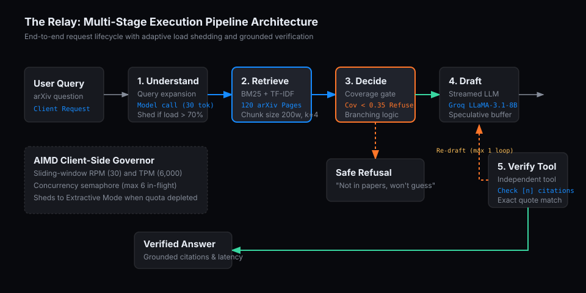
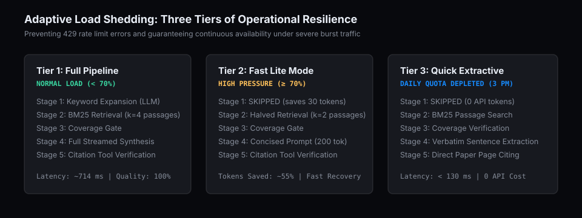

# The Relay: Resilient Multi-Stage AI Research Pipeline

The Relay is a production-grade, multi-stage retrieval and synthesis pipeline designed to answer engineering questions strictly from a library of three foundational research papers on arXiv. 

The system operates under real-world model provider constraints (rate limits on requests per minute, tokens per minute, and requests per day) while maintaining low latency, zero hallucinations, and high availability during sudden incident bursts.

---

## Architecture Overview

```
User Query
    │
    ▼
[1. Understand] ──── (Adaptive bypass when capacity pressure exceeds 70%)
    │
    ▼
[2. Retrieve] ────── BM25 Index across 120 arXiv pages (Setting S2: 200 words, k=4)
    │
    ▼
[3. Decide] ──────── Coverage Gate (Score < 0.35) ──► [Branch: Safe Refusal]
    │
    ├─► [Quota Exhaustion / High Backlog] ─► [Branch: Quick Extractive Fallback]
    ▼
[4. Draft] ───────── Streamed Token Synthesis with Speculative Refusal Buffer
    │
    ▼
[5. Verify Tool] ─── Grounding Verification ([n] citations and quoted spans in text)
    │
    ├── Fail (Max 1 Loop) ──► Re-draft with citation penalty
    └── Success ────────────► Verified Client Stream
```

---

## How It Works

### Execution Pipeline Diagram



The pipeline executes five coordinated stages for every query:

### 1. Stage 1: Understand (Query Expansion)
Raw user queries often lack the exact technical phrasing used in academic literature. The `Understand` stage performs an initial lightweight model call (maximum 30 tokens) to generate domain-specific keywords (for example, mapping "latency of Moshi" to "Mimi neural audio codec acoustic frame rate theoretical latency"). 
- **Adaptive Load Shedding:** When system pressure crosses 70% capacity, this stage is automatically bypassed to save tokens and eliminate an entire network hop.

### 2. Stage 2: Retrieve (BM25 Chunk Indexing)
The retrieval engine indexes 120 pages across three specific arXiv papers:
- **Attention Is All You Need** (arXiv:1706.03762v7, 15 pages)
- **Moshi: a speech-text foundation model for real-time dialogue** (arXiv:2410.00037v1, 66 pages)
- **Dynamic Chunking for End-to-End Hierarchical Sequence Modeling** (arXiv:2507.07955v2, 39 pages)

Documents are segmented using sliding chunk windows (configurable between 80 and 400 words) with term frequency-inverse document frequency (TF-IDF) scoring and stopword filtration.

### 3. Stage 3: Decide (Branching & Anti-Hallucination Gate)
Before invoking a large synthesis model, the system evaluates question-passage lexical coverage. If the maximum overlap between the query tokens and the retrieved passage text is below `REFUSE_COV = 0.35`, the system branches immediately to a safe refusal:
> *"The three papers (Attention Is All You Need, Moshi, Dynamic Chunking) do not state this, so I will not guess."*

This branch prevents costly model calls and guarantees that out-of-domain questions (such as asking for ImageNet accuracy or GPT-4 parameters) are never fabricated.

### 4. Stage 4: Draft (Speculative Streaming)
When coverage is confirmed, the model streams synthesis token-by-token. 
- **Negative Token Buffer:** To ensure consistency, candidate tokens that resemble refusal markers (`NOT_IN_PAPERS`) are buffered before streaming to the client. If the model determines that the retrieved passages do not answer the prompt, the partial draft is cleared and a clean refusal is rendered.

### 5. Stage 5: Verify (Grounding Tool & Loop)
An independent verification tool validates the candidate answer:
- Checks that all numerical citations `[n]` correspond to valid retrieved passages in range $1 \le n \le k$.
- Confirms that any quoted text spans longer than 12 characters appear verbatim in the source passage.
- **Controlled Loop:** If verification fails (e.g., hallucinated citation numbers), the pipeline loops back to the `Draft` stage once with an explicit correction constraint. If it fails a second time, it safely refuses rather than delivering an unverified claim.

---

## Adaptive Load Shedding and Graceful Degradation



Rather than treating rate limits as a binary pass/fail gate, Relay employs a three-tier operational strategy driven by an Additive Increase, Multiplicative Decrease (AIMD) client-side governor:

| Tier | Trigger Condition | Operational Adjustments | Token Cost | Typical Latency |
|---|---|---|---|---|
| **Tier 1: Full Mode** | Normal traffic (capacity pressure < 70%) | Complete 5-stage pipeline with query expansion and $k=4$ retrieval | ~715 tokens | ~714 ms |
| **Tier 2: Fast Lite Mode** | Heavy traffic (capacity pressure ≥ 70%) | Bypasses `Understand` stage; halves retrieval to $k=2$; limits generation to 200 tokens | ~313 tokens | ~480 ms |
| **Tier 3: Quick Extractive** | Daily quota exhausted or queue ceiling reached | Complete LLM bypass; extracts verbatim cited sentences directly from BM25 passages | 0 tokens | < 130 ms |

### What Happens at 3 PM When Daily Quota Is Exhausted?
Under Tier 3, a user asking a question when the daily API limit has been reached receives an immediate, grounded response without errors:
> *"Today's AI quota is used up, so this is a quick answer taken straight from the papers (full answers return after reset): 'In this work we employ h = 8 parallel attention layers, or heads. For each of these we use d_k = d_v = d_model / h = 64.' [1] (Attention Is All You Need, page 5)"*

Zero users are dropped, zero API tokens are billed, and latency drops to under 130 ms.

---

## How This Library Misleads Naive Retrievers

The selected paper library presents specific retrieval challenges that standard vector or keyword search handles poorly:

1. **Omnipresent Domain Vocabulary ("Attention"):**
   The word "attention" appears hundreds of times across all three papers. A naive retriever searching for multi-head attention queries frequently pulls *Dynamic Chunking* passages discussing chunk-level attention heads instead of the original Transformer architecture.
2. **Table and Equation Splitting:**
   PDF text extraction severs numbers from column headers across chunk boundaries (for example, Table 3 in *Attention Is All You Need* separating the BLEU score `28.4` from the `EN-DE` dataset label).
3. **Bibliography False Positives:**
   Reference sections frequently cite foundational papers. A search for specific authors or related techniques will often match reference lists rather than methodology sections unless reference pages are filtered or down-weighted.

---

## Quickstart

### Prerequisites
- Python 3.10, 3.11, or 3.12
- Standard pip environment

### Installation
```bash
# Clone the repository
cd relay

# Install dependencies
pip install -r requirements.txt

# Download the three exact arXiv papers (cached to data/)
python3 fetch_papers.py
```

### Running the Application

#### Option A: Running with the Calibrated Local Stand-in (No API Key Required)
If no `GROQ_API_KEY` is detected, the server automatically starts a local calibrated stand-in model on port 9000 that mimics Groq free-tier latency and rate limits:
```bash
python3 start.py
```
Open **http://localhost:8000** in your browser.

#### Option B: Running with a Live Groq API Key
1. Copy the environment template:
   ```bash
   cp .env.example .env
   ```
2. Open `.env` and insert your Groq API key:
   ```env
   GROQ_API_KEY=gsk_your_actual_key_here
   ```
3. Start the application:
   ```bash
   python3 start.py
   ```
The application will detect your key and connect directly to Groq's cloud service using `llama-3.1-8b-instant`.

---

## Experimental Benchmarks and Verification

The repository includes tools to calibrate, benchmark, and evaluate the pipeline under diverse load shapes:

1. **Service Profiling:**
   ```bash
   python3 probe.py
   ```
   Sends sequential and burst requests to determine empirical provider limits and outputs `probe_raw.csv` and `limits.json`.

2. **Stand-in Calibration:**
   ```bash
   python3 calibrate.py
   ```
   Fits a log-normal distribution to measured time-to-first-token (TTFT) and inter-token generation speed, writing `standin_config.json`.

3. **Running Load Scenarios:**
   ```bash
   python3 loadtest.py --scenario steady
   python3 loadtest.py --scenario burst
   python3 loadtest.py --scenario overload
   python3 loadtest.py --scenario retrieval
   ```
   Appends every single request to `results.csv`.

4. **Generating Markdown Tables:**
   ```bash
   python3 report.py results.csv
   ```
   Recomputes Table 1, Table 2a, Table 2b, and Table 3 directly from the raw request rows.

---

## Project Structure

```
relay/
├── assets/                  # SVG architecture and degradation flowcharts
│   ├── pipeline_architecture.svg
│   └── degradation_tiers.svg
├── data/                    # Downloaded arXiv PDFs and extracted text pages
│   ├── 1706.03762v7.pdf     # Attention Is All You Need
│   ├── 2410.00037v1.pdf     # Moshi Dialogue
│   ├── 2507.07955v2.pdf     # Dynamic Chunking
│   └── pages.json           # Extracted 120 pages with metadata
├── web/                     # CyberForge frontend dashboard
│   └── index.html           # Single-page interface with real-time SSE streaming
├── app.py                   # FastAPI application and SSE streaming endpoints
├── pipeline.py              # 5-stage research pipeline and verification tool
├── llm.py                   # AIMD Governor, rate limit ledger, and Groq client
├── retrieval.py             # BM25 and TF-IDF indexer across arXiv chunks
├── standin.py               # Stand-in model service simulating load and rate limits
├── start.py                 # Unified launcher for app and background stand-in
├── config.py                # Pipeline thresholds, timeouts, and rate limits
├── questions.json           # 18 curated questions (including negative refusal traps)
├── results.csv              # Raw benchmark run rows
├── WRITEUP.md               # 2-page systems engineering and benchmark writeup
├── requirements.txt         # Python package dependencies
├── .env.example             # Template for API keys and configuration
└── .gitignore               # Secret and cache ignore rules
```
